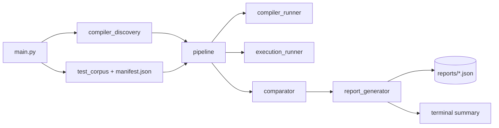

# CompilerDiff — Automated Compiler Verification Toolkit

> **Educational project. Not a production compiler verification system.**

Compiles small, valid, deterministic C programs with every available compiler/optimization
configuration (GCC/Clang x `-O0`/`-O2`), runs them, and compares observable behavior
(stdout, stderr, exit code). A difference is reported as a **potential discrepancy needing
investigation** — never as proof of a compiler bug.

## Why it matters
Compiler verification checks that optimization changes *speed*, not *behavior*. Differential
testing needs no oracle: the same valid program must behave identically at `-O0` and `-O2`
and across compilers. Assembly is never compared (different code can be equivalent).

## Architecture


## Setup (Windows)
Needs Python 3.10+ and at least one of: GCC, Clang, or MSVC `cl` (Visual Studio Build Tools, "Desktop development with C++"). GCC/Clang must be on PATH; on Windows CompilerDiff loads the Visual Studio environment itself, which Clang also needs for the C headers.
```powershell
python -m venv .venv
.\.venv\Scripts\python.exe -m pip install -r requirements.txt   # pytest only
winget install MSYS2.MSYS2        # then in MSYS2: pacman -S mingw-w64-ucrt-x86_64-gcc ; add its bin to PATH
winget install LLVM.LLVM          # clang
```
Run commands from the project folder. Missing compilers are reported, never crash the tool.

## CLI
```powershell
python main.py check                    # detect compilers + versions (exit 2 if none)
python main.py list-tests
python main.py run                      # all tests, -O0 and -O2
python main.py run --test arithmetic    # --test is repeatable
python main.py run --opt -O0 -O1 -O2 --timeout 5 --output reports\my.json
python -m pytest -q
```
`run` exit codes: 0 all good, 1 any failure/discrepancy, 2 usage/no compiler.

## Report
JSON (`reports/report_<id>.json`, git-ignored) contains: `run_id`, `timestamp`, `os`, `python`,
`compilers` (path/version/availability), and per test: `source`, `expected_stdout`,
`comparison` (`match` | `potential_discrepancy` | `single_configuration` | `no_comparable_results`),
and per config: `compile` (command, return code, diagnostics), `execution` (stdout, stderr,
return code, timeout info), `config_status` (`pass`, `fail_expected`, `compile_failed`, `timeout`, ...).
Output is stored un-normalized; normalization (line endings + trailing whitespace) is used only for comparing.

## Test strategy
Unit tests mock `subprocess` (comparison, return codes, missing compilers, compile failure,
timeout, JSON validity with odd characters, test selection). End-to-end tests (full corpus,
compile-error + real timeout, CLI report) run only if a **working** compiler exists, else skip.

## Verified status on the author's machine (2026-10-09)
- Compilers: Clang 23.1.3 and MSVC cl 19.51 (GCC not installed). On Windows, CompilerDiff loads the Visual Studio environment (vswhere + vcvars64.bat) inside its own process so clang/cl find the C headers.
- `main.py run`: 13 tests x 4 configurations = 52 compiled and executed, 52 passed, 13/13 cross-configuration matches, 0 discrepancies.
- `pytest -q -rs`: 36 passed, 0 skipped (includes tests/test_discrepancy.py).
- GCC, nvcc, ptxas absent; CUDA not exercised.

## Known limitations
- Timeouts are **not a security sandbox**; only the bundled trusted corpus is executed. Never point it at untrusted code.
- No random program generation; fixed corpus only. No Linux/macOS testing. Floating point, `rand`, and pointers printing are deliberately avoided.
- Compile timeout is fixed (60 s); output is compared as text.

## Add a C test
1. Add `corpus/<name>.c` (valid C11, no UB, deterministic output).
2. Add an entry in `corpus/manifest.json`: `name`, `file`, `description`, `expected_stdout`, optional `expected_returncode`.
3. `python main.py list-tests`, then `python main.py run --test <name>`.

## Add a compiler / configuration
- New optimization level: `python main.py run --opt -O0 -O1 -O3` (or edit `DEFAULT_OPT_LEVELS` in `src/pipeline.py`).
- New compiler (e.g. `cc`): add to `SUPPORTED_COMPILERS` and `INSTALL_HINTS` in `src/compiler_discovery.py`; adjust `build_command` in `src/compiler_runner.py` if flags differ.

## CUDA/PTX (future, untested)
`nvcc`/`ptxas` were not available, so nothing CUDA was run. [`examples/cuda_vector_add.cu`](examples/cuda_vector_add.cu)
is a clearly labelled **untested** example; with the CUDA Toolkit: `nvcc -ptx examples/cuda_vector_add.cu -o vector_add.ptx`
(no GPU needed to emit PTX). A future extension could assemble PTX with `ptxas` and check it assembles for several `--gpu-name` targets.

## How comparison works / discrepancy validation
See [LEARNING_GUIDE.md](LEARNING_GUIDE.md). Briefly: builds of the same test are grouped by (exit code, stdout, stderr) after ignoring only line endings and trailing whitespace; more than one group is reported as a **potential discrepancy** to investigate, not a compiler bug. `tests/test_discrepancy.py` validates this with simulated results.

See also [PROJECT_WALKTHROUGH.md](PROJECT_WALKTHROUGH.md) for a code walkthrough with line numbers, audit findings and interview questions.
